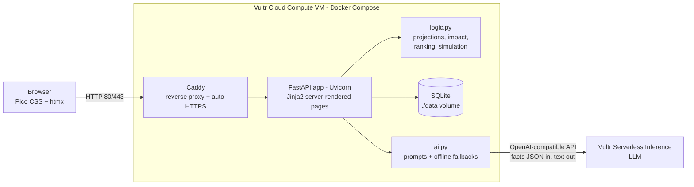
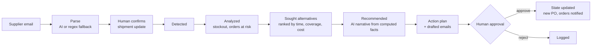

# NavigateDeezNuts

**An AI supply chain disruption agent for businesses.**
Built for the Vultr Agent Rush hackathon, Track 02: *Powering the Future of Work*.

NavigateDeezNuts watches inbound shipments, reads supplier emails, works out what a delay really means
(when stock runs out, which customer orders are at risk, what it costs to fix), ranks alternative suppliers,
writes an executive recommendation and drafts the emails. Then it waits for a human to approve the plan.
Approving the plan updates the business state: a purchase order is placed, stock is reserved and customers are notified.

---

## The problem and the business value

When a supplier emails "your shipment is 10 days late", a planner has to answer questions that take hours
across spreadsheets, ERP screens and inboxes:

- Will we run out of stock before the shipment arrives? On which day?
- Which customer orders slip, and which of them are high priority?
- Who else can supply us in time, and what does that cost?
- What do we tell the supplier and the affected customers?

NavigateDeezNuts answers all of these in seconds and turns the answer into a ready-to-approve action plan.

- **Faster response:** from supplier email to approved mitigation in under a minute.
- **Fewer missed customer orders:** shortages are found before they happen, not after.
- **Cost control:** every option shows its total cost and premium over the primary supplier.
- **Trustworthy AI:** the AI never calculates. Python computes every number and the AI only writes the narrative,
  with the computed facts shown next to it. Humans approve every action.

## Features

| Page | What it does |
|---|---|
| **Dashboard** `/` | KPI cards, colour-coded shipments table (at-risk rows highlighted), component stock cover, live agent activity feed (auto-refresh with htmx), agent scan, demo reset, optional CSV import |
| **Impact page** `/shipments/{id}` | Agent workflow trace (Detected → Analyzed → Sought alternatives → Recommended → Awaiting approval), AI recommendation and the computed facts it was given, stockout date with and without the delay, 60-day stock projection chart (server-rendered SVG), orders at risk, ranked alternative suppliers, "Generate action plan" |
| **Ingest email** `/ingest` | Paste a supplier email; the AI (or a regex fallback) extracts supplier, product, quantity, new date and reason; you confirm and the shipment is updated. Includes a sample email button |
| **Simulator** `/simulator` | What-if scenarios: supplier unavailable for N days, shipment delayed N days, raw material cost +X%. Runs on a copy of the data and is clearly labelled **SIMULATION - hypothetical** |
| **Action Center** `/actions` | Approve or reject proposed actions, read the drafted supplier and customer emails. Approving a reorder creates a new shipment; approving notifications marks orders as "customer notified" |
| **Activity** `/activity` | Full log of everything the agent did |
| **API** | `/health` → `{"status":"ok"}`, `/api/shipments` → JSON |

## Architecture



How a disruption flows through the agent:



## Tech stack

- **Backend:** Python 3.12, FastAPI, Uvicorn, Jinja2, SQLite (standard `sqlite3`, parameterized SQL, no ORM)
- **AI:** `openai` Python client pointed at Vultr Serverless Inference (OpenAI-compatible)
- **Frontend:** server-rendered HTML, [Pico CSS](https://picocss.com) and [htmx](https://htmx.org) from the jsDelivr CDN, inline SVG charts. No Node, no build step
- **Deployment:** Docker, Docker Compose, Caddy 2 (automatic HTTPS)
- **Tests:** pytest + FastAPI TestClient (89 tests)

All dependencies are free and open source and pinned in `requirements.txt`.

## How Vultr is used

1. **Vultr Cloud Compute VM** runs the whole backend: the FastAPI app, the SQLite database and the Caddy reverse proxy (Docker Compose).
2. **Vultr Serverless Inference** provides the LLM, through its OpenAI-compatible endpoint `https://api.vultrinference.com/v1`. The AI has three jobs:
   - parse a pasted supplier email into structured JSON (`supplier, product, quantity, new_delivery_date, reason`);
   - write a short executive recommendation from the computed facts;
   - draft a supplier follow-up email and a customer delay notification.

If `VULTR_MODEL` is not set, the app calls `models.list()` once, keeps only models whose metadata says they output text,
prefers Qwen, Llama or Mistral and fast "flash" variants, and logs the model it picked.
Every AI call has a 30 s timeout, 2 retries and a deterministic template fallback. The UI shows
**"AI: Vultr Serverless Inference"** or **"AI: offline fallback"** next to each AI output.

## Run it locally

Requires Python 3.12.

```bash
git clone https://github.com/muhmmadsudais/NavigateDeezNuts.git
cd NavigateDeezNuts
python3 -m venv .venv
source .venv/bin/activate          # Windows: .venv\Scripts\activate
pip install -r requirements.txt
uvicorn app.main:app --reload
```

Open http://127.0.0.1:8000. No configuration is needed: the database is created and seeded automatically
and the AI runs in offline fallback mode.

To use the real LLM:

```bash
cp .env.example .env               # then put your key in VULTR_API_KEY
set -a; source .env; set +a        # load it into the shell
uvicorn app.main:app --reload
```

## Run the tests

```bash
source .venv/bin/activate
pytest
```

Tests use a temporary database and disable the LLM, so they need no API key and no network.

## Deploy on Vultr (Ubuntu 24.04)

**1. Create the VM.** In the Vultr portal: *Deploy → Cloud Compute*, image **Ubuntu 24.04 LTS x64**.
The smallest plan with 1 vCPU and 1–2 GB RAM is enough. Add your SSH key and deploy, then note the public IP.

**2. SSH in and install Docker:**

```bash
ssh root@YOUR_VM_IP
apt-get update
apt-get install -y docker.io docker-compose-v2 git
systemctl enable --now docker
docker compose version             # should print v2.x
```

**3. Clone and configure:**

```bash
git clone https://github.com/muhmmadsudais/NavigateDeezNuts.git
cd NavigateDeezNuts
cp .env.example .env
nano .env                          # paste your VULTR_API_KEY (optional, the app works without it)
```

**4. Start it:**

```bash
docker compose up -d --build
docker compose ps                  # web should become "healthy"
curl http://localhost/health       # {"status":"ok"}
```

**5. Open the firewall.** Vultr Ubuntu images ship with `ufw` enabled:

```bash
ufw allow 22/tcp
ufw allow 80/tcp
ufw allow 443/tcp
ufw status
```

If you also use a Vultr *Firewall Group* (portal → Network → Firewall), allow TCP 22, 80 and 443 there too.

Your public demo URL is now **http://YOUR_VM_IP/**.

**6. Optional HTTPS with a domain.** Point a DNS A record at the VM's IP, edit `Caddyfile`
(replace the `:80 { ... }` block with the commented domain example), then run `docker compose restart caddy`.
Caddy obtains a free Let's Encrypt certificate automatically.

**Useful commands:**

```bash
docker compose logs -f web                  # app logs (shows which AI model was selected)
git pull && docker compose up -d --build    # deploy an update
docker compose exec web pytest              # run the test suite inside the container
docker compose down                         # stop (data stays in ./data)
```

The SQLite database lives in `./data/navigatedeeznuts.db` on the VM and survives restarts and rebuilds.
Use the "Reset demo data" button to restore the sample data.

## Environment variables

| Variable | Required | Default | Description |
|---|---|---|---|
| `VULTR_API_KEY` | No | *(empty)* | Vultr Serverless Inference API key. Without it, the app uses offline fallbacks |
| `VULTR_BASE_URL` | No | `https://api.vultrinference.com/v1` | OpenAI-compatible endpoint |
| `VULTR_MODEL` | No | *(auto)* | Exact model id. If empty, a text chat model is picked automatically from `models.list()` |
| `NDN_DB_PATH` | No | `data/navigatedeeznuts.db` | SQLite file location (tests use a temp file) |
| `NDN_DISABLE_LLM` | No | *(empty)* | Set to `1` to force offline fallback mode |

The API key is never logged or shown in the UI. `.env` is in `.gitignore`.

## Demo script (2–3 minute video)

1. **Healthy dashboard (20 s).** Open `/`. Click **Reset demo data**. Point out the KPI cards: 9 active shipments,
   0 at-risk, 9 suppliers monitored. Only SH-1044 (screens) has a minor 2-day delay, marked "Watch", with no stockout.
   Mention the live agent activity feed.
2. **A supplier email arrives (25 s).** Go to **Ingest email**, click **Load sample delay email** (TechParts Ltd.:
   SH-1042, 5,000 microchips, power outage, new date 10 days later). Click **Extract details**. Show the extracted
   fields and the AI badge. Click **Confirm and update shipment**.
3. **The agent detects and analyzes (40 s).** You land on the SH-1042 impact page. Walk through the workflow trace
   (Detected → Analyzed → Sought alternatives → Recommended). Point at the facts: 1,500 microchips on hand and
   1,000 used per week, so stock runs out about 6 days before the delayed shipment arrives. Two customer orders are at risk
   (Acme Robotics, high priority; Nordic Devices). Show the red section of the stock chart between "Stockout" and "Shipment ETA".
4. **Recommendation (20 s).** Read the AI recommendation and show the computed facts under it: every number comes from Python.
   The ranked suppliers table shows ChipSource Asia delivers in 4 days, before the stockout, at a known premium.
5. **What-if (25 s).** Open **Simulator** and run "Supplier unavailable for N days" with TechParts Ltd., 14 days,
   then "Raw material cost +X%" with Microchips, 15%. Point out the **SIMULATION - hypothetical** banner: nothing real changed.
6. **Approve actions (30 s).** Back on SH-1042, click **Generate action plan**. In the **Action Center**, open the drafted supplier
   and customer emails. **Approve** the reorder, reserve and notify actions.
7. **Status updates (15 s).** The customer orders table now shows Acme Robotics as "Reserved + notified" and Nordic Devices as "Customer notified". On the dashboard,
   a new ChipSource Asia shipment appears, at-risk shipments drop back to 0, and the activity feed shows every step.
   Close by showing `/health`, `/api/shipments` and the footer: "Backend on Vultr Cloud Compute, AI by Vultr Serverless Inference".

## Limitations / what's simulated

- **All data is sample data**, generated at startup with dates relative to today. No real ERP, supplier or customer systems are connected.
- **Emails are not actually sent.** Approving "notify customers" or "request commitment" records the action and updates statuses only.
- **Simulations are hypothetical.** They run on an in-memory copy and never change the database.
- The stock model is deliberately simple: constant daily usage, shipments arrive in full on their ETA, 60-day horizon.
  Orders count as "at risk" if they fall due between the stockout date and the date stock recovers.
- Alternative suppliers are ranked by: arrives before the stockout, then covers the full shortage, then lowest total cost, then reliability.
- There is no login. For a public demo that's fine; for real use, add authentication in front of the app.
- CSV import is a convenience feature with basic validation: all-or-nothing, max 1 MB.

## Project structure

```
app/
  main.py        routes, error pages, chart + workflow helpers
  logic.py       all calculations (pure Python, unit tested)
  ai.py          Vultr LLM client, prompts, JSON extraction, offline fallbacks
  db.py          SQLite schema, seed data, helpers
  templates/     Jinja2 pages (base.html + one per page + shared partials)
  static/        style.css
tests/           pytest unit + smoke tests
data/            SQLite database (created at runtime)
Dockerfile, docker-compose.yml, Caddyfile, docker-entrypoint.sh
requirements.txt, .env.example, .gitignore
```

## License

MIT, see [LICENSE](LICENSE).
